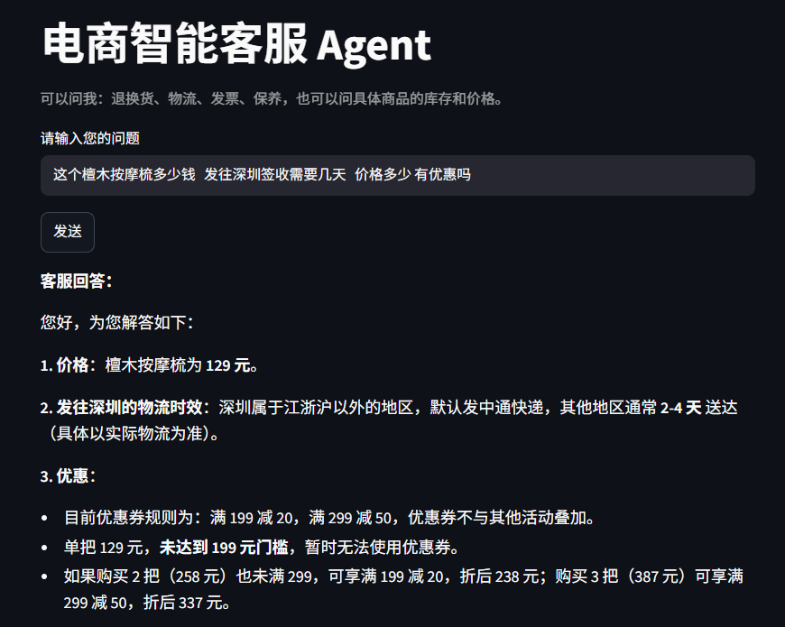

# 电商智能客服 Agent

一个基于大模型的电商客服助手。能回答政策类问题（文案生成以及详情图、卖点、退换货、物流、发票、保养,），也能查询具体商品的库存和价格。

## 功能特点

- 语义检索：用向量检索从知识库中找最相关的资料，支持口语化提问（例如"我不想要了"）
- 查询改写：先把用户的口语问题改写成规范问句再检索，显著提高命中率
- 工具调用：模型自主决定调用函数，查询实时库存与价格
- 不编造：资料中没有的内容如实告知，不虚构答案
- 网页界面：用 Streamlit 搭建，一键运行

## 技术栈

Python / DeepSeek 对话模型 / BGE-M3 向量模型 / 余弦相似度向量检索 / Function Calling / Streamlit

## 工作原理

1. 用户提问
2. 查询改写：把口语问题改写成一句明确的检索问句
3. 向量检索：从知识库中找出最相关的两条资料
4. 把资料、问题、工具清单一起发给大模型
5. 如果模型要求调用工具，执行函数并把结果回传
6. 模型生成最终回答

## 如何运行

1. 安装依赖：`pip install openai streamlit`
2. 在代码中填入 DeepSeek 和硅基流动的 API 密钥
3. 运行：`streamlit run app_kefu.py`

## 效果示例

- 用户：我不想要了
  → 客服：签收后 7 天内、商品未使用且包装完好，可以申请无理由退货……

- 用户：檀木按摩梳还有货吗？可以便宜点吗
  → 客服：库存 56 件，售价 129 元；满 199 减 20，可搭配其他商品使用优惠券……

## 项目文件说明

- `app_kefu.py`：客服主程序（向量检索 + 工具调用 + 网页界面）
- `app.py`：电商文案批量生成器
- `README.md`：项目说明
- `词汇表.md`：学习过程中积累的术语表
 